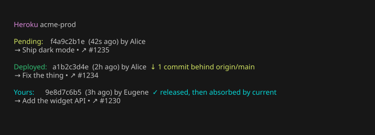

<p align="center">
  
</p>

<div align="center">

### See what's on air - which commit is actually running in production.

[](https://rubygems.org/gems/onair-cli)
[](https://github.com/amberpixels/onair-cli/actions/workflows/ci.yml)
[](LICENSE)

</div>

---

<p align="center">
  
</p>

`onair` tells you which commit production is running. It reads the running
release, not the newest build, so it stays correct after a rollback.

It never deploys or rolls back. The one thing it writes is a lazy
`git fetch`. It needs nothing beyond the Ruby standard library. Offline or
with commits missing, it still prints a useful report instead of a stack
trace.

Heroku, Dokku and GitHub Deployments are supported. GitHub Deployments is
the one exception to reading the running release: it shows what CI
recorded, not what the host runs.

## Install

```sh
gem install onair-cli
```

Requires Ruby >= 3.2.

## Usage

```
onair              # status report for the current repo
onair init         # write .onair.yml; --justfile appends a `prod` recipe
onair --json       # machine-readable status
onair --app NAME   # override the app for one invocation
onair --no-fetch   # never fetch git objects from the remote
```

Exit code `0` is success and `1` is an error. Color is off when stdout is not
a TTY or `NO_COLOR` is set.

If a GitHub token is available (`GH_TOKEN`, `GITHUB_TOKEN` or a logged-in
`gh`), the head of `origin/<branch>` comes from the GitHub API (~0.4s).
`git ls-remote` runs alongside and answers when there is no token, the
remote is not GitHub, or the API fails. Both read the live remote, never a
cache.

### The report

| Row | Meaning |
|---|---|
| **Deployed** | The running commit, its age and author, and `★ current` or `↓ N commits behind` against `origin/main`. No marker when the relation is unknown. |
| **Rollout** | Dynos (Dokku: containers) per process type on that release, e.g. `⟳ rolling out v1234: web 1/3, 2 starting`. Shows `✓ rolled out` once every dyno runs it. |
| **Pending** | A build in flight that will replace the deploy. |
| **Releasing** | A newer release still in its release phase. Production still runs Deployed. |
| **Failed** | The newest release failed its release phase and never went live. Shown until a newer one succeeds. |
| **⏸ pinned** | A newer build succeeded but is not running, after a rollback or because a release is pinned. |
| **Yours** | Your commit sits just below someone else's deployed one, so it went out with their deploy. |

The release phase is the command a platform runs before a release goes
live, such as database migrations.

Heroku preboot starts the new web dynos before stopping the old ones, so
the old ones keep serving for about three minutes. Rollout shows that
handoff as an estimate. On Dokku the estimate is the app's wait-to-retire
after the newest build.

## Configuration

`.onair.yml`, searched upward from the working directory to the git root:

```yaml
platform: heroku
app: acme-prod
repo: acme/widgets   # for PR/commit links; default: inferred from origin
branch: main         # comparison branch; default: main
```

CLI flags win over env vars (`HEROKU_APP`, `GITHUB_REPO`), which win over
`.onair.yml`. `HEROKU_APP` applies only with `platform: heroku`.

### Heroku

Auth reuses the Heroku CLI token from `~/.netrc` (`heroku login`), falling
back to `heroku auth:token`.

### Dokku

```yaml
platform: dokku
host: my-dokku   # any SSH destination: dokku@host, or a ~/.ssh/config alias
app: myapp
```

Needs Dokku 0.38+ and `ssh`. onair runs
`ssh -o BatchMode=yes <host> <command> <app> --format json`. The host must
log in as the `dokku` user, directly or via an alias with `User dokku`.
`BatchMode` never prompts, so a key with a passphrase must be loaded with
`ssh-add` first.

Deployed is the commit that the last `git push` to Dokku deployed. An app
deployed another way (such as `git:from-image` or `git:sync`) shows the
deploy source instead. Dokku builds record no commit, so Pending and Failed
name the build, and pinned is never shown.

### GitHub Deployments

For hosts most developers cannot reach. If CI records each deploy as a GitHub
Deployment, anyone who can read the repo sees what is deployed.

```yaml
platform: github_deployments
repo: acme/widgets       # default: inferred from origin
environment: production  # default: production
```

No `app:` is needed. onair reads the environment's last 10 deployments and
the newest status of each. The token comes from `GH_TOKEN`, `GITHUB_TOKEN`
or `gh auth token`, and needs read access to deployments. Without one, onair
asks you to run `gh auth login`.

- **Deployed** is the newest `success` deployment.
- **Pending** is a newer `queued`, `pending` or `in_progress` one.
- **Failed** is a newer `failure` or `error` one.
- A deployment with no status yet is ignored.
- With no success among the last 10, the report says so in one line, below
  any Pending or Failed row.
- If the status of a deployment newer than the deployed one cannot be read,
  onair fails rather than show an older commit as running.

**This reports what CI recorded, not what the host runs.** A deploy that
bypassed CI stays invisible until the next recorded one. A CI job that
records the sha it pushed is also wrong if the host ends up running
something else. So have CI record the sha the host reports after the deploy:

```yaml
permissions:
  deployments: write
steps:
  - uses: actions/checkout@v4
  - name: Deploy
    env:
      GH_TOKEN: ${{ github.token }}
    run: |
      id=$(gh api repos/${{ github.repository }}/deployments \
        -f ref=${{ github.sha }} -f environment=production \
        -F auto_merge=false -f 'required_contexts[]' --jq .id)
      gh api repos/${{ github.repository }}/deployments/$id/statuses -f state=in_progress
      if ./deploy.sh && [ "$(./running-sha.sh)" = "${{ github.sha }}" ]; then
        state=success
      else
        state=failure
      fi
      gh api repos/${{ github.repository }}/deployments/$id/statuses -f state=$state
```

`running-sha.sh` asks the host which commit it runs, so a mismatch is
recorded as a failure.

### Task links

```yaml
task:
  pattern: 'ABC-\d+'                              # any Ruby regex
  url: 'https://acme.atlassian.net/browse/{task}' # {task} = the matched id
```

Task ids in commit subjects become terminal hyperlinks with the same text, and `--json` adds a
`task` object (`{ "id", "url" }`) per commit. Without a `task:` section
nothing changes.

## JSON

`onair --json` prints one object. The schema is a public API and only
changes additively.

```json
{
  "app": "acme-prod",
  "platform": "heroku",
  "branch": "main",
  "repo": "acme/widgets",
  "environment": null,
  "remote_head": "<sha>",
  "deployed": {
    "sha": "<sha>", "version": 1234, "description": "Deploy a1b2c3d4",
    "deployed_at": "2026-06-12T10:00:00Z", "subject": "Fix the thing (#1234)",
    "author": "Eugene", "task": null
  },
  "pending": null,
  "release": null,
  "rollout": {
    "version": 1234, "complete": true,
    "processes": [
      { "type": "web", "up": 3, "total": 3, "waiting": {}, "previous": 0 }
    ],
    "overlap_until": null
  },
  "delta": { "status": "current", "behind_by": 0 },
  "pinned": null,
  "yours": null
}
```

- `delta.status`: `"current"`, `"behind"` or `"unknown"`.
- `environment`: the GitHub Deployments environment, else `null`. On that
  platform `app` is `null`, and `deployed` is `null` when none of the last 10
  succeeded.
- `pending`: `{ "sha", "build_id", "started_at", "subject", "author" }` while
  a build is in flight. On Dokku `sha` is `null` and `build_id` names the
  build. Elsewhere `build_id` is `null`.
- `release`: `{ "sha", "version", "description", "status", "started_at",
  "subject", "author" }` for a newer release that is not live. `status` is
  `"pending"` (release phase running) or `"failed"`. While its sha differs,
  `delta.status` is never `"current"`. On Dokku it is a failed build with a
  `null` sha.
- `version`: `null` on platforms that number no releases (Dokku, GitHub
  Deployments).
- `rollout`: dynos per process type, or `null` when they can't be read.
  It is always `null` on GitHub Deployments.
  `up` counts dynos serving the running release. `waiting` counts the rest
  by state (`starting`, `crashed`, ...). `previous` counts dynos on an older
  release. `overlap_until` estimates the end of a preboot handoff while it
  lasts, else `null`. `complete` is true once every dyno serves the running
  release and no handoff remains.
- `pinned`: `{ "version", "description", "latest_built_sha" }` when a newer
  build succeeded but is not running.
- `yours`: `{ "sha", "had_own_build", "subject", "author" }` when your commit
  sits just below the deployed head.
- `subject`/`author`: `null` when the commit isn't in the local repo.
- `task`: `{ "id", "url" }` when a `task:` matcher is configured and the
  subject matches, else `null`.

## Development

```sh
bundle install
bundle exec rake        # specs + standard
```

`reference/prod-release.sh`, the bash script this gem came from, is the
behavioral source of truth. `spec/onair/report_spec.rb` ports its rules.

## License

[MIT](LICENSE)
